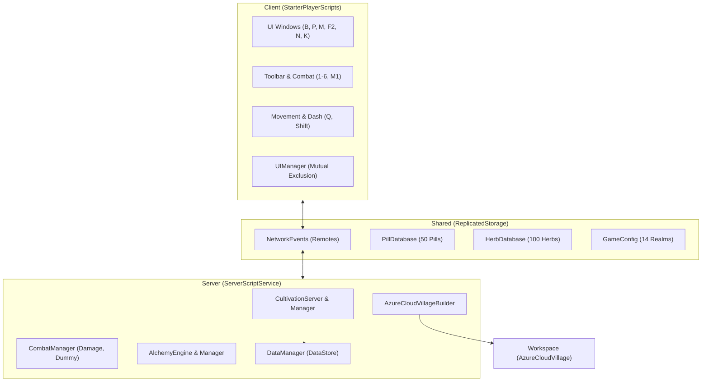
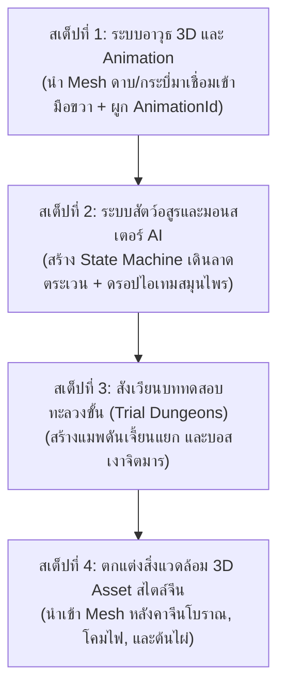

# รายงานสถานะและการวิเคราะห์สถาปัตยกรรมโค้ดเบสฉบับสมบูรณ์
**ชื่อโปรเจกต์:** มหาศึกสำนักเซียนสะท้านฟ้า (*Daoist Boundless / Genesis of the Myriad Gods*)  
**แพลตฟอร์ม:** Roblox (Luau Engine)  
**เครื่องมือจัดการโครงสร้าง:** Rojo (Modular Client-Server-Shared Architecture)  
**วันที่จัดทำรายงาน:** 6 พฤศจิกายน 2026  

---

## 1. บทนำและภาพรวมสถาปัตยกรรม (System Architecture Overview)

โปรเจกต์นี้ได้รับการพัฒนาขึ้นโดยใช้แนวคิด **Decoupled Event-Driven Modular Architecture** บนภาษา Luau เพื่อรองรับระบบเกมแนว Xianxia / Wuxia Open-World RPG ขนาดใหญ่ โดยแยกสถาปัตยกรรมออกเป็น 3 ฝั่งหลักอย่างชัดเจน:

1. **Shared Layer (`ReplicatedStorage`):** แหล่งเก็บข้อมูลคงที่ (Databases), การกำหนดค่าระบบ (Configurations), ตัวจัดการหน้าต่างส่วนกลาง (UIManager) และช่องทางการสื่อสารเครือข่าย (Network Remotes)
2. **Server Layer (`ServerScriptService`):** หัวใจหลักในการประมวลผล Logic ของเกม การตรวจสอบความปลอดภัย (Anti-Cheat / Hit Verification), การคำนวณสูตรยา, วงจรบำเพ็ญเพียร, การจัดเก็บข้อมูลถาวร (DataStore) และการสร้างสิ่งแวดล้อมเชิงรหัส (Procedural World Generation)
3. **Client Layer (`StarterPlayerScripts`):** การตอบสนองต่อผู้เล่น (User Inputs), อินเตอร์เฟซ (UIs), มุมกล้อง, เอฟเฟกต์ภาพ (VFX), ตัวเลขดาเมจลอย 3D และฟิสิกส์การเคลื่อนไหวของตัวละคร



---

## 2. โครงสร้างไฟล์ทั้งหมดในโปรเจกต์ (File Directory Map)

```text
src/
├── PlayerInventory.lua                                   [Legacy / Stub]
├── ReplicatedStorage/
│   ├── InventoryManager.lua                             [Legacy / Stub]
│   ├── Main.lua                                         [Legacy / Stub]
│   ├── Remotes/
│   │   └── NetworkEvents.lua                            [Active] ตัวสร้างและเชื่อมต่อ RemoteEvents/Functions
│   └── SharedModules/
│       ├── GameConfig.lua                               [Active] ค่าคงที่ 14 ขอบเขตพลัง, อัตราบัฟ, ค่าสเตตัส
│       ├── HerbDatabase.lua                             [Active] ฐานข้อมูลสมุนไพร 100 ชนิดและเวกเตอร์ธาตุ
│       ├── PillDatabase.lua                             [Active] สารสารบบมหาตำราโอสถ 50 ขนาน 6 สำนัก
│       └── UIManager.lua                                [Active] ตัวจัดการปิด-เปิดหน้าต่าง UI ป้องกันการซ้อนทับ
├── ServerScriptService/
│   ├── AdminServer.server.lua                           [Active] ประมวลผลคำสั่งแอดมิน, เสกไอเทม, เสกดัมมี่
│   ├── AlchemyCauldronServer.server.lua                 [Active] จัดการการโต้ตอบเตาหลอมยาในหมู่บ้าน
│   ├── AlchemyEngine.lua                                [Active] เอนจินคำนวณเวกเตอร์เคมีโอสถ, เตาแตก, ขี้ยา
│   ├── AlchemyManager.lua                               [Active] บันทึกการค้นพบยา, จัดการบัฟและการหลอมยา
│   ├── AzureCloudVillageBuilder.server.lua              [Active] สคริปต์ Procedural สร้างหมู่บ้าน 600x600 studs
│   ├── CombatManager.lua                                [Active] เซิร์ฟเวอร์คำนวณดาเมจ, ระบบดัมมี่, หลอดเลือด
│   ├── CultivationManager.lua                           [Active] คำนวณแต้มตบะ, ทะลวงขั้น, สเตตัสตัวละคร
│   ├── CultivationServer.server.lua                     [Active] วงจรสมาธิ Heartbeat, ตรวจสอบคอขวด 100%
│   ├── DataManager.server.lua                           [Active] ระบบ DataStore บันทึกกระเป๋า ยา สมุนไพร เงิน
│   ├── HerbSpawnerServer.server.lua                     [Active] เกิดสมุนไพรตามแมพตามโซนและฤดูกาล
│   ├── InventoryManager.lua                             [Legacy / Stub]
│   ├── Main.lua                                         [Legacy / Stub]
│   ├── MerchantServer.server.lua                        [Active] ซื้อขายไอเทมกับ NPC พ่อค้า
│   ├── PartyManager.lua                                 [Active] ระบบปาร์ตี้และการยกเว้นดาเมจพวกเดียวกัน
│   ├── ServerMain.lua                                   [Legacy / Stub]
│   └── WeatherTimeServer.server.lua                     [Active] ระบบ 4 ฤดูกาล และวงรอบกลางวัน-กลางคืน
└── StarterPlayer/
    └── StarterPlayerScripts/
        ├── AdminTerminalClient.client.lua               [Active] หน้าต่างคอนโซลแอดมิน F2 และปุ่มคำสั่งด่วน
        ├── AlchemyUI.client.lua                         [Active] UI หม้อหลอมยา 3 แท็บ (มินิเกม, ตำรา, กระเป๋า)
        ├── CharacterStatusUI.client.lua                 [Active] หน้าต่างตัวละคร P สเตตัส ขอบเขตพลัง ออร่า
        ├── CultivationClient.client.lua                 [Active] ปุ่ม M นั่งสมาธิ, ดอกบัวหมุน, เตือนคอขวด, Lore ทะลวงขั้น
        ├── GatheringClient.client.lua                   [Active] เก็บสมุนไพรในแมพพร้อมแอนิเมชันและเสียง
        ├── HerbCompendiumUI.client.lua                  [Active] สารานุกรมสมุนไพร 100 ชนิด ปุ่ม K
        ├── InventoryUI.client.lua                       [Active] กระเป๋าช่อง RPG 5x5 ปุ่ม B, พรีวิว 3D, แผงตรวจสอบ
        ├── LocalButtonScript.lua                        [Legacy / Stub]
        ├── LocalScript.lua                              [Legacy / Stub]
        ├── MerchantUI.client.lua                        [Active] หน้าต่างร้านค้าซื้อขายสมุนไพร/โอสถ
        ├── MovementClient.client.lua                    [Active] กลิ้งหลบ Q, กระโดด 2 ชั้น, วิ่งลมปราณ Shift
        ├── PartyUI.client.lua                           [Active] หน้าต่างปาร์ตี้ N เชิญเพื่อน แสดงเลือดทีม
        ├── ToolbarCombatClient.client.lua               [Active] แถบ Hotbar 1-6, คลิกซ้าย M1 ฟันดาบ, ดาเมจลอย 3D
        └── ZoneControllerClient.client.lua              [Active] ตรวจจับ Safe Zone และ Wild Zone ขึ้นแจ้งเตือน
```

---

## 3. รายละเอียดระบบที่ "ใช้งานได้สมบูรณ์ 100%" (Fully Functional Systems)

### 3.1 ระบบบำเพ็ญเพียร, การนั่งสมาธิ และระบบล็อกคอขวด (Cultivation & Bottleneck)
* **ไฟล์หลัก:** `CultivationServer.server.lua`, `CultivationManager.lua`, `CultivationClient.client.lua`, `GameConfig.lua`
* **สถานะการทำงาน:** **สมบูรณ์ 100%**
* **ฟังก์ชันการทำงาน:**
  1. **สมาธิควบคุมการเดินของตบะ:** แต้มบำเพ็ญเพียร (Tapasya/Exp) จะไม่เพิ่มขึ้นเรื่อยๆ ตอนเดินเล่น จะเริ่มเดินก็ต่อเมื่อผู้เล่นกดนั่งสมาธิ (ปุ่ม `M` หรือกดปุ่ม `[🧘 นั่งสมาธิ]` บน HUD)
  2. **ตรวจจับการเคลื่อนไหว:** หากผู้เล่นเดิน วิ่ง กระโดด หรือได้รับแรงผลัก ระบบจะสั่งยกเลิกการนั่งสมาธิทันทีเพื่อป้องกันการบอท
  3. **เอฟเฟกต์ภาพ (VFX):** สร้างฐานดอกบัวเรืองแสงหมุนวนใต้ฝ่าเท้าและอนุภาคละอองปราณลอยขึ้นสู่ฟากฟ้า
  4. **ระบบหยุดนิ่งที่คอขวด 100%:** เมื่อแต้มตบะสะสมจนถึงค่าสูงสุดของขั้นนั้นๆ (`Exp >= RequiredExp`) แต้มจะถูกล็อกตายตัวที่ 100% ไม่เพิ่มขึ้นอีก พร้อมขึ้นป้ายเตือนสีแดงกะพริบ `🔒 ติดคอขวด 100% (กด P เพื่อเปิดหน้าต่างทะลวงขั้น)`
  5. **14 ขอบเขตพลัง:** แบ่งเป็น 7 ขอบเขตแห่งกายมนุษย์ และ 7 ขอบเขตแห่งวังฟ้าจักรวาล ปรับสเกลค่าพลังชีวิต พลังปราณ ความเร็ว พลังโจมตี และพลังป้องกันตามจริง

### 3.2 ระบบคลังสัมภาระแบบช่องตาราง RPG 5x5 (Grid-Slot Inventory)
* **ไฟล์หลัก:** `InventoryUI.client.lua`, `DataManager.server.lua`
* **สถานะการทำงาน:** **สมบูรณ์ 100%**
* **ฟังก์ชันการทำงาน:**
  1. **ปุ่มเปิด-ปิด:** กดปุ่ม `B` เพื่อเปิดคลังสมบัติ
  2. **รูปแบบตาราง (Slot Grid):** แสดงผล 25 ช่อง (5x5) พร้อมกรอบสไตล์คลาสสิก Xianxia
  3. **การคัดกรองแท็บหมวดหมู่:** แท็บทั้งหมด (`All`), แท็บสมุนไพร (`🌿`), แท็บเม็ดยา (`💊`), แท็บอาวุธ (`⚔️`)
  4. **การแสดงผล 3D ViewportFrame:** แต่ละช่องมีโมเดล 3D หมุนวนแสดงประเภทไอเทมและสีประจำธาตุ พร้อมตัวเลขแสดงจำนวน (Stack Counter)
  5. **แผงตรวจสอบไอเทม (Item Inspector):** เมื่อคลิกไอเทมใดๆ ฝั่งขวาจะแสดงหน้าต่างข้อมูลละเอียด ประกอบด้วย:
     * ชื่อไอเทมและระดับขั้น (Tier / Grade)
     * หมวดหมู่และธาตุประจำตัว
     * คำอธิบายสรรพคุณตามตำรา
     * ปุ่มแอ็กชันเฉพาะ: `[💊 กลืนโอสถ]` สำหรับเม็ดยา, `[⚔️ ติดตั้งอาวุธ]` สำหรับอาวุธ, และ `[🔥 นำไปหลอมยา]` สำหรับสมุนไพร

### 3.3 ระบบ Hotbar ช่อง 1-6 และการต่อสู้พื้นฐาน (Combat & Toolbar System)
* **ไฟล์หลัก:** `ToolbarCombatClient.client.lua`, `CombatManager.lua`
* **สถานะการทำงาน:** **สมบูรณ์ 100%**
* **ฟังก์ชันการทำงาน:**
  1. **ช่องไอเทมด่วน:** แถบ 6 ช่องด้านล่างหน้าจอ ช่อง 1 คือหมัดเปล่า (`👊 ฝ่ามือไร้ลักษณ์`) ช่อง 2-6 สวมใส่อาวุธหรือไอเทมยาจากกระเป๋าได้
  2. **การสลับสล็อต:** กดปุ่มตัวเลข `1` ถึง `6` บนคีย์บอร์ด
  3. **การโจมตี (M1 Click):** คลิกเมาส์ซ้ายเพื่อฟัน/โจมตี เล่นแอนิเมชันเหวี่ยงแขน พร้อมสร้างคลื่นประกายดาบนีออน (Slash Trail Arc) หน้าตัวละคร
  4. **การตรวจจับ Hitbox:** ใช้ Raycast คำนวณระยะห่าง ทิศทาง และตรวจจับเป้าหมายที่มี Humanoid
  5. **ตัวเลขดาเมจลอย 3D (Floating Damage Numbers):** เมื่อฟันโดนเป้าหมาย จะสุ่มตัวเลขดาเมจคำนวณตามพลังโจมตีและพลังป้องกัน เด้งลอยขึ้นเป็นตัวเลข 3D เหนือหัวและจางหายไป
  6. **ระบบดัมมี่ซ้อมดาเมจ (Training Dummy):** รองรับการเสกดัมมี่ที่มีหลอดเลือด 3D Billboard ด้านบน มีแอนิเมชันสั่นเมื่อโดนตี และมีระบบฟื้นฟูเลือดอัตโนมัติหากไม่โดนโจมตีเกิน 5 วินาที
  7. **ระบบความปลอดภัย:** ตีผู้เล่นใน Safe Zone ไม่ได้รับดาเมจ และไม่สามารถทำร้ายผู้เล่นในปาร์ตี้เดียวกันได้

### 3.4 เอนจินปรุงยาพลวัตและสารบบ 50 ขนานยา (Dynamic Pharmacopoeia Engine)
* **ไฟล์หลัก:** `PillDatabase.lua`, `HerbDatabase.lua`, `AlchemyEngine.lua`, `AlchemyManager.lua`, `AlchemyUI.client.lua`
* **สถานะการทำงาน:** **สมบูรณ์ 100%**
* **ฟังก์ชันการทำงาน:**
  1. **ฐานข้อมูลสมุนไพร 100 ชนิด:** บันทึกค่าเวกเตอร์ธาตุ (ไฟ, น้ำ, ไม้, ดิน, ทอง, พลังชีวิต, มิติ), ความแรง (Potency), ความเสถียร (Stability) และความเข้ากันได้
  2. **สารบบมหาตำราโอสถ 50 ขนาน:** ครอบคลุม 6 สำนักใหญ่ (ฟื้นชีพ, ทลายชีพจร, เสริมปราณยุทธ์, ชำระจิต, พิษและเงา, วัฏจักรดวงดาว)
  3. **ระบบ 5 บทบาทตัวยา:** จัดสรรสมุนไพรลงตำแหน่ง จักรพรรดิ (King), ขุนนาง (Minister), ผู้ช่วย (Assistant), ผู้ส่งสาร (Envoy), และตัวทำละลาย (Solvent)
  4. **ระบบเตาแตกระเบิด & ขี้ยา:** หากความเสถียรของสูตรยาต่ำกว่า 30% หรือคุมไฟพลาด เตาจะระเบิด ผู้เล่นกระเด็นเสียเลือด 30 หน่วย และได้รับ "ขี้ยาไร้ค่า (Slag)"
  5. **UI เตาหลอมโอสถ 3 แท็บ:**
     * *หม้อหลอม (Cauldron):* ใส่สมุนไพร 5 ช่อง และเล่นมินิเกมคุมอุณหภูมิไฟ
     * *บันทึกสูตรยา (Recipe Log):* แสดงแถบความคืบหน้า (เช่น `ค้นพบแล้ว 12/50 สูตร`) สูตรที่ยังไม่ปลดล็อกจะขึ้นคำใบ้ปริศนา
     * *กระเป๋าโอสถ (Pill Pouch):* แสดงเม็ดยาที่ผู้เล่นหลอมสำเร็จ

### 3.5 ตัวจัดการหน้าต่างส่วนกลางไม่ให้เปิดทับกัน (UI Mutual Exclusion Manager)
* **ไฟล์หลัก:** `UIManager.lua`
* **สถานะการทำงาน:** **สมบูรณ์ 100%**
* **ฟังก์ชันการทำงาน:**
  * ป้องกันบั๊กหน้าต่างเมนูเปิดทับซ้อนกัน เมื่อผู้เล่นกดเปิดหน้าต่างใดหน้าต่างหนึ่ง (กระเป๋า B, สเตตัส P, สารานุกรมสมุนไพร K, ปาร์ตี้ N, แอดมิน F2, ร้านค้า หรือหน้าต่างทะลวงขั้น) ระบบจะสั่งปิดหน้าต่างอื่นทันที

### 3.6 ระบบคอนโซลและปุ่มคำสั่งแอดมิน (Admin Terminal & Commands)
* **ไฟล์หลัก:** `AdminServer.server.lua`, `AdminTerminalClient.client.lua`
* **สถานะการทำงาน:** **สมบูรณ์ 100%**
* **ฟังก์ชันการทำงาน:**
  * กดปุ่ม `F2` เพื่อเปิดคอนโซล
  * ปุ่มลัดด่วน:
    * `[🌿 เสกสมุนไพร 100 ชนิด]`: เสกสมุนไพรทั้งหมดเข้ากระเป๋าแบบ Bulk ครั้งเดียว
    * `[💊 เสกโอสถ 50 ขนาน]`: เสกเม็ดยาทั้งหมดเข้ากระเป๋าและอัปเดตช่องใช้งานทันที
    * `[🎯 เสกดัมมี่ซ้อมดาเมจ]`: เสกดัมมี่เลือด 1,000 หน่วยตรงหน้าผู้เล่น
    * `[⚡ ทะลวงขั้นเซียน]`: บังคับเพิ่มระดับขอบเขตพลังทันที 1 ขั้น
    * `[💰 เติม 99,999 ตำลึง]`
    * `[🧹 ล้างดัมมี่]`
  * รองรับการพิมพ์คำสั่งผ่าน Command Parser พร้อมระบบแยกคำ (Tokenizer) ป้องกันบั๊กข้อความติดกัน

### 3.7 ระบบการเคลื่อนไหววิชาตัวเบา (Movement, Dodge Roll & Dash)
* **ไฟล์หลัก:** `MovementClient.client.lua`
* **สถานะการทำงาน:** **สมบูรณ์ 100%**
* **ฟังก์ชันการทำงาน:**
  * **กลิ้งหลบ/พุ่งตัว (ปุ่ม `Q`):** ปรับระยะพุ่งให้ไกลขึ้นตามแรงส่งฟิสิกส์ พร้อมเอฟเฟกต์หมุนตัวและภาพติดตา (Ghost Afterimage)
  * **กระโดดสองชั้น (Double Jump):** ดีดตัวกลางอากาศพร้อมวงแหวนคลื่นลมสีคราม
  * **วิ่งลมปราณ (Shift):** เพิ่มความเร็วการเคลื่อนที่ตามระดับขั้นบำเพ็ญ

### 3.8 ระบบสภาพอากาศ กาลเวลา และฤดูกาล (Weather & Season System)
* **ไฟล์หลัก:** `WeatherTimeServer.server.lua`, `HerbSpawnerServer.server.lua`
* **สถานะการทำงาน:** **สมบูรณ์ 100%**
* **ฟังก์ชันการทำงาน:**
  * ระบบวงรอบกลางวัน-กลางคืน ปรับแสง เงา หมอก และสีท้องฟ้าแบบ Dynamic
  * ระบบ 4 ฤดูกาล: วสันตฤดู, คิมหันตฤดู, สารทฤดู, เหมันตฤดู ส่งผลต่อการงอกของสมุนไพรหายากในแต่ละโซน

---

## 4. รายละเอียดระบบที่ "ทำโค้ดไว้แล้ว แต่ยังทำงานได้บางส่วน / รอโมเดลและคอนเทนต์" (Partially Working / Mocked / Awaiting Assets)

| หัวข้อระบบ | โค้ดส่วนที่เสร็จแล้ว (Logic & Backend) | ส่วนที่ยังขาด / ยังเป็นตัวจำลอง (Mock / Pending) | ผลกระทบในเกมปัจจุบัน |
| :--- | :--- | :--- | :--- |
| **1. มินิเกมด่านทดสอบทะลวงขั้น (Breakthrough Trials)** | เขียนเงื่อนไข ภารกิจ Lore และหน้าต่างกดยืนยันครบใน `GameConfig.lua` และ `CultivationClient.client.lua` | **ยังเป็นระบบจำลอง (Simulated):** เมื่อกด "เริ่มบททดสอบ" โค้ดจะจำลองว่าผ่านทันที เพราะยังไม่ได้สร้างห้องดันเจี้ยนเฉพาะในแมพ (เช่น มิติมืดเงาจิต, แท่นประหารเซียน) | ผู้เล่นสามารถเลื่อนขั้นได้จริง แต่ยังไม่ได้เข้าไปสู้ในห้องบอสจริง |
| **2. โมเดล 3D ไอเทมในกระเป๋า (Item 3D Models)** | มีระบบ ViewportFrame 3D หมุนได้ 360 องศาในช่องกระเป๋าและแผง Inspector ครบถ้วน | **ใช้รูปทรงเรขาคณิตจำลอง (Mock Gems):** ปัจจุบันใช้ผลึกคริสตัล/ทรงเพชรเปลี่ยนสีตามธาตุแทน เนื่องจากยังไม่มีไฟล์ MeshPart ของต้นสมุนไพรหรือเม็ดยาจริง | ไอเทมแสดงผลหมุนได้สวยงาม แต่รูปทรงยังเป็นก้อนผลึก ไม่ใช่รูปต้นหญ้าหรือเม็ดยา |
| **3. การถือโมเดลอาวุธ 3D ที่มือตัวละคร (Equipped Weapon Mesh)** | มีตรรกะสวมใส่, สลับช่อง Hotbar, คำนวณระยะฟัน, และเอฟเฟกต์ประกายดาบแสงเลเซอร์ | **ยังไม่มีชิ้นส่วน Mesh อาวุธติดมือ:** ตัวละครใช้การขยับแขนเปล่าๆ ฟันแล้วมีคลื่นแสงออกมา ยังไม่มีโมเดลกระบี่หรือดาบ 3D เชื่อม (Weld) อยู่ที่มือขวา | โจมตีและทำดาเมจได้จริง มีเอฟเฟกต์ฟัน แต่ที่มือตัวละครยังมองไม่เห็นด้ามดาบ |
| **4. แอนิเมชัน R15 ของตัวละคร (Character Animations)** | โค้ดคำนวณทิศทางการกลิ้งหลบ, การดีดตัวกระโดดสองชั้น และการเหวี่ยงแขนฟัน | **ใช้ Procedural CFrame/Velocity Tweens:** ยังไม่ได้ผูก AnimationId ของ R15 (เช่น ท่าม้วนตัวกลิ้งกับพื้น หรือท่ายกกวัดแกว่งเพลงดาบจีน) ต้องรอผู้ใช้อัปโหลด Animation เข้า Asset ID ของตนเอง | ตัวละครเคลื่อนที่และเหวี่ยงแขนตามโค้ด แต่ท่วงท่ายังไม่พลิ้วไหวเท่าแอนิเมชันสำเร็จรูป |
| **5. ระบบมอนสเตอร์ AI เดินลาดตระเวน (Monster & Boss AI)** | ระบบรับดาเมจ, เลือด, ป้องกัน, คริติคอล และหลอดเลือด 3D ทำไว้ใน `CombatManager.lua` (ใช้งานผ่าน Training Dummy ได้แล้ว) | **ยังไม่มี AI เดินและใช้สกิล:** มอนสเตอร์และสัตว์อสูรตามโซนป่ายังไม่มีพฤติกรรมเดินลาดตระเวน (Pathfinding) หรือกระโดดโจมตีผู้เล่น | ปัจจุบันมีดัมมี่ซ้อมตีเพื่อทดสอบดาเมจได้ แต่ยังไม่มีมอนสเตอร์เดินไล่ตีผู้เล่นในป่า |
| **6. โมเดลสิ่งปลูกสร้างหมู่บ้านเมฆาคราม (Village 3D Assets)** | รหัส `AzureCloudVillageBuilder.server.lua` สร้างโครงสร้าง 600x600 studs, แม่น้ำ, สะพาน, ศาลา, ร้านยา, แท่นวาร์ป, และ Safe Zone ครบถ้วน | **สร้างด้วยบล็อกเรขาคณิตพื้นฐาน (Procedural Primitives):** ชิ้นส่วนอาคารทำจาก Part/SmoothPlastic/Slate สไตล์ Blockout ยังไม่ใช่โมเดลสถาปัตยกรรมจีนโบราณแบบ Mesh ความละเอียดสูงจาก Blender | แผนที่สามารถเดิน สำรวจ ข้ามสะพาน และเข้าโซนปลอดภัยได้จริง แต่ภาพรวมยังเป็นสไตล์ Low-poly |

---

## 5. รายการไฟล์ Template เริ่มต้นที่ไม่ได้ใช้งานแล้ว (Legacy Stubs)

ไฟล์เหล่านี้เป็นไฟล์ตัวอย่างตั้งต้นก่อนการยกเครื่องสถาปัตยกรรม สามารถลบออกได้โดยไม่มีผลข้างเคียงต่อตัวเกม:

1. `src/ReplicatedStorage/InventoryManager.lua`: สคริปต์กระเป๋าเวอร์ชันทดสอบแรก (ถูกแทนที่ด้วย `DataManager.server.lua` และ `InventoryUI.client.lua`)
2. `src/ServerScriptService/InventoryManager.lua`: สคริปต์กระเป๋าฝั่งเซิร์ฟเวอร์เวอร์ชันแรก
3. `src/PlayerInventory.lua`: คลาสทดลองคลังไอเทม
4. `src/StarterPlayer/StarterPlayerScripts/LocalButtonScript.lua`: สคริปต์ดักปุ่ม B และ E แบบเก่า (ปัจจุบันย้ายไปคุมผ่าน `InventoryUI` และ `GatheringClient`)
5. `src/ServerScriptService/Main.lua` & `src/ServerScriptService/ServerMain.lua`: ไฟล์ Boilerplate ว่างเปล่า

---

## 6. ข้อเสนอแนะและแผนงานลำดับถัดไป (Recommended Next Steps)

เพื่อให้โปรเจกต์พร้อมสำหรับการเปิดทดสอบ Close-Alpha อย่างสมบูรณ์แบบ แนะนำให้ดำเนินการตามลำดับดังนี้:



---
*จัดทำและตรวจสอบความถูกต้องโดยระบบวิเคราะห์โค้ดอัตโนมัติ Antigravity Engine*
