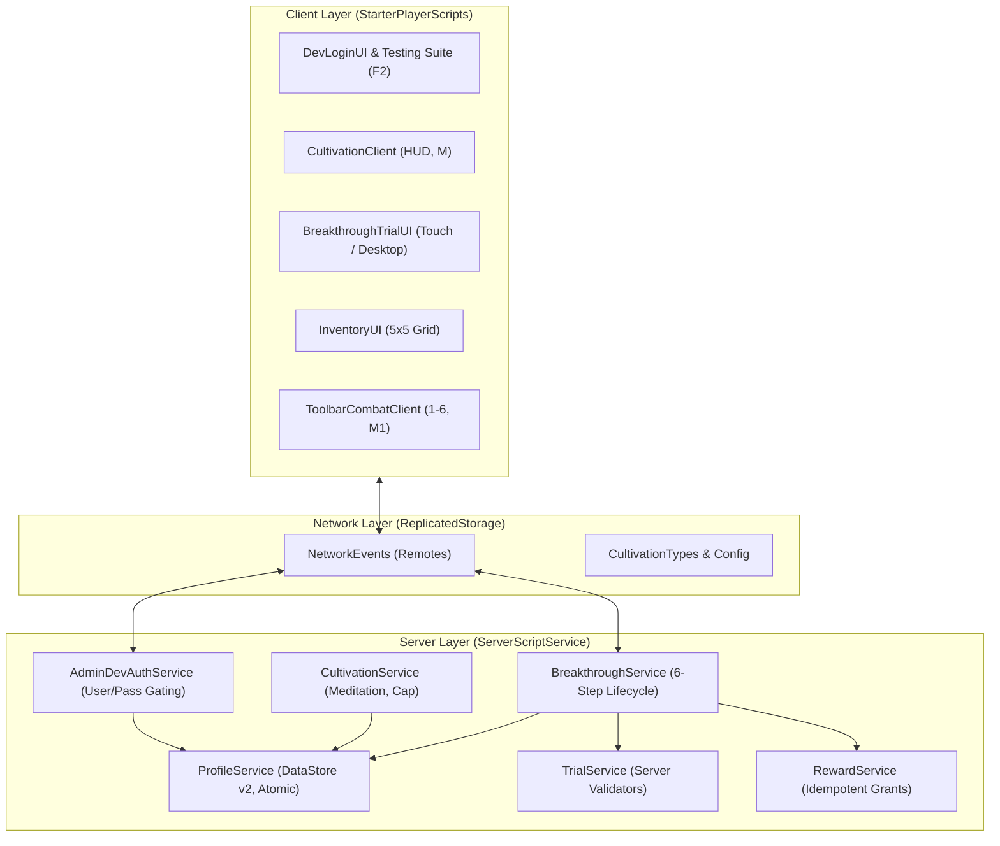

# คู่มือเอกสารระบบและรายงานผลการทดสอบ (System Architecture & MVP Documentation)
**เกม:** Genesis of the Myriad Gods: Daoist Boundless (มหาศึกสำนักเซียนสะท้านฟ้า)  
**เวอร์ชันระบบ:** Core System MVP — Phase 1-3 Playable Baseline  
**วันที่จัดทำ:** 6 พฤศจิกายน 2026  
**สถานะการคอมไพล์ (Rojo Build):** ผ่านสมบูรณ์ (Exit Code 0)

---

## 1. ภาพรวมการปรับปรุงโครงสร้างตาม MVP (Architecture Refactoring)

ตามข้อกำหนด **Core System MVP Development Specification** ระบบได้รับการยกเครื่องสถาปัตยกรรมใหม่ทั้งหมดเพื่อตัดปัญหาโค้ดซ้ำซ้อนและป้องกันการโกงจาก Client โดยยึดหลัก **Server-Authoritative Progression** ข้อมูลทั้งหมดมี **Single Source of Truth** เพียงจุดเดียวใน `ProfileService.lua`:

---

## 2. คู่มือสำหรับผู้พัฒนา (Dev Quickstart & Authentication Guide)

เพื่อความปลอดภัยสูงสุด ระบบปิดกั้นไม่ให้ผู้เล่นทั่วไปเปิดใช้งานคำสั่งหรือหน้าต่าง Admin จนกว่าจะทำการยืนยันตัวตนระดับ Dev ผ่านรหัสผ่านที่กำหนดไว้

### บัญชีผู้พัฒนาเริ่มต้น (Default MVP Dev Credentials)
* **Username:** `dev` *(หรือ `admin`)*
* **Password:** `daoist2026` *(หรือ `gods2026`)*

### วิธีการเข้าสู่โหมด Dev (2 วิธี)
1. **ผ่าน UI หน้าจอ (แนะนำ):**
   * กดปุ่ม `F2` บนคีย์บอร์ด หรือแตะปุ่ม `[⚙️ Dev Mode (F2)]` ที่มุมขวาบนของหน้าจอ
   * หากยังไม่ได้ล็อกอิน จะมีหน้าต่าง **"ผู้ทดสอบระบบ (Dev Authentication)"** ปรากฏขึ้น
   * กรอก `dev` และ `daoist2026` แล้วกดปุ่ม `[🔑 ยืนยันตัวตน (Dev Login)]`
   * ระบบจะปลดล็อก **ศูนย์ทดสอบระบบสำหรับผู้พัฒนา (Dev Testing Suite)** ทันที
2. **ผ่าน Chat Command:**
   * พิมพ์ในช่องแชต: `/devauth dev daoist2026` หรือ `/login dev daoist2026`

---

## 3. ปุ่มคำสั่งลัดบน Dev Testing Suite สำหรับทดสอบ MVP

เมื่อยืนยันตัวตนแล้ว หน้าต่าง Dev Testing Suite จะมีปุ่มลัดสำหรับทดสอบฟีเจอร์ของสเปก MVP ได้ทันทีเพียงคลิกเดียว:

| ปุ่มบนหน้าต่าง Dev | สิ่งที่ระบบดำเนินการเบื้องหลัง | จุดประสงค์การทดสอบ |
| :--- | :--- | :--- |
| **`[🧪 ทดสอบ Trial 1 (ครรภ์เซียน)]`** | เสก `โอสถเบิกวิญญาณ` 1 เม็ดเข้ากระเป๋า + ปรับแต้มตบะเป็น 1000/1000 (สถานะ Ready) + เปิดหน้าต่างพิธีทะลวงขั้นทันที | ทดสอบวงจร Trial 1: มินิเกมจังหวะลมหายใจ 3 ห้วง |
| **`[🌀 ทดสอบ Trial 2 (เบญจธาตุ)]`** | เสกแก่นธาตุทั้ง 5 (`แก่นปฐพี, แก่นโลหะ, แก่นวารี, แก่นพฤกษา, แก่นอัคคี`) อย่างละ 1 ชิ้น + ปรับขั้นเป็น Realm 2 ตบะเต็ม 2500/2500 + เปิดหน้าต่างพิธีทันที | ทดสอบวงจร Trial 2: มินิเกมวัฏจักรก่อเกิด ดิน→ทอง→น้ำ→ไม้→ไฟ |
| **`[⚡ บังคับทะลวงขั้น (Fast)]`** | สั่ง Server เลื่อนขอบเขตพลังทันทีโดยข้ามเงื่อนไขบททดสอบ | ทดสอบการเปลี่ยนสเตตัสและขอบเขตขั้นสูง |
| **`[🎯 เสกดัมมี่ซ้อมตี (1000 HP)]`** | สร้างหุ่นฟางที่มีหลอดเลือด 3D, รองรับการทดสอบดาเมจ, แสดงตัวเลขดาเมจลอย และฟื้นฟูเลือดอัตโนมัติ | ทดสอบระบบต่อสู้ (Combat) และสูตรดาเมจ |
| **`[🧹 ล้างดัมมี่ทั้งหมด]`** | เคลียร์หุ่นซ้อมตีทั้งหมดออกจากแมพ | จัดการสิ่งแวดล้อมให้สะอาด |
| **`[🌿 เสกสมุนไพร 100 ชนิด]`** | เติมสมุนไพรทุกชนิดลงกระเป๋า ชนิดละ 10 ต้น | ทดสอบการปรุงยาในหอโอสถ |
| **`[💊 เสกโอสถ 50 ขนาน]`** | เติมเม็ดยาทั้ง 50 ขนาน ชนิดละ 5 เม็ด | ทดสอบการกินยา บัฟ และระบบควิกสล็อต |
| **`[🛡️ โหมดอมตะ (Godmode)]`** | ปรับ MaxHealth และ MaxQi เป็น 999,999 หน่วย | เดินสำรวจโดยไม่ต้องกังวลเรื่องเลือดหมด |
| **`[🏃 วิ่งเร็ว x2 (Speed 32)]`** | ปรับ WalkSpeed ของตัวละครเป็น 32 | สำรวจแมพ 600x600 studs ได้รวดเร็ว |
| **`[💰 เติม 99,999 ตำลึง]`** | เพิ่มเงินในกระเป๋าสำหรับซื้อของที่ร้านค้า | ทดสอบระบบเศรษฐกิจและร้านค้า NPC |

---

## 4. รายงานสถานะการทำงานของแต่ละระบบ (Component Status Report)

### 4.1 ระบบที่ทำงานได้สมบูรณ์ตามข้อกำหนด MVP (100% Functional)

| ระบบ | รายละเอียดการทำงานตามข้อกำหนด | สถานะ |
| :--- | :--- | :---: |
| **1. วงจรตบะและการนั่งสมาธิ (Cultivation Loop)** | • ตบะ (CultivationExp) จะเพิ่มขึ้นก็ต่อเมื่อนั่งสมาธิเท่านั้น (`IsMeditating == true`) • มีปุ่ม `[🧘 นั่งสมาธิ (M)]` บน HUD และรองรับปุ่ม `M` • หากเดิน วิ่ง หรือกระโดด สมาธิจะถูกตัดทันที • เมื่อตบะเต็มเพดาน (RequiredExp) แต้มจะล็อกนิ่งที่ 100% ทันที ไม่เดินต่อ และเปลี่ยนสถานะเป็น `BreakthroughState = Ready` • มีป้ายเตือนสีแดงกะพริบ `🔒 ติดคอขวด 100% (แตะเพื่อทำพิธี)` | **สมบูรณ์** |
| **2. วงจรพิธีทะลวงขั้นมาตรฐาน (Breakthrough Lifecycle)** | • เป็นไปตามข้อกำหนด 6 ขั้นตอนของ Section 4: 1. ตรวจสอบความพร้อม (Exp เต็ม + วัตถุดิบครบ) 2. หน้าต่างแสดงสรุป Lore, วัตถุดิบ และปุ่มยกเลิก 3. หักวัตถุดิบแบบ Atomic ทันทีที่กดยืนยันเริ่มพิธี 4. เข้าสู่มินิเกมบททดสอบตามชนิดขอบเขต 5. ตัดสินผลบน Server และมอบรางวัลแบบ Idempotent 6. ล้มเหลวไม่เสียระดับตบะหลักหรือลดขั้น Realm | **สมบูรณ์** |
| **3. บททดสอบขั้นที่ 1: ครรภ์เซียน (Trial 1: Breathing Rhythm)** | • **เงื่อนไข:** ตบะ 1000/1000 + โอสถเบิกวิญญาณ 1 เม็ด • **มินิเกม:** วงแหวนปราณหด-ขยายแสดงจังหวะหายใจ 3 ช่วง (ช่วงที่ 1: รวบรวม, ช่วงที่ 2: ชำระชีพจร, ช่วงที่ 3: จุดไฟตันเถียน) • รองรับการแตะหน้าจอบนมือถือ และกด Spacebar บน PC • ตรวจสอบ Timing Window บน Server อย่างยุติธรรม พลาดจะให้เริ่มนับจังหวะใน Phase เดิมใหม่ ไม่เสียความก้าวหน้าหลัก • **รางวัล:** ปลดล็อกหลอดพลังปราณ MaxQi 100 หน่วย, ปลดล็อกระบบทะลวงขั้นถัดไป | **สมบูรณ์** |
| **4. บททดสอบขั้นที่ 2: เบญจธาตุ (Trial 2: Five Elements Generation)** | • **เงื่อนไข:** ตบะ 2500/2500 + แก่น 5 ธาตุ (`แก่นปฐพี, แก่นโลหะ, แก่นวารี, แก่นพฤกษา, แก่นอัคคี`) • **มินิเกม:** หน้าต่างวงล้อ 5 ธาตุ Touch-friendly มีแสงและคำใบ้นำทาง • ผู้เล่นต้องกดถ่ายทอดธาตุตามลำดับวัฏจักรก่อเกิด: **ดิน → ทอง → น้ำ → ไม้ → ไฟ** • Server ตรวจสอบลำดับ หากกดผิดจะรีเซ็ตรอบวัฏจักร ไม่เสียเลือดรุนแรง • **รางวัล:** ปลดล็อก Elemental Affinity, โบนัสต้านทานธาตุ +15%, MaxHealth 160, MaxQi 150 | **สมบูรณ์** |
| **5. การสำรวจและเก็บเกี่ยวทรัพยากร (Gathering & Exploration)** | • ในหมู่บ้านเมฆาคราม มีจุดเกิด **แก่นธาตุทั้ง 5** สถิตตามจุดสำคัญตามธรรมชาติ:   - *เสาพลังปฐพี (ดิน)* บริเวณเชิงผาหิน   - *ศิลาแร่ทองคำสัจจะ (ทอง)* บริเวณลานประลองยุทธ์   - *บ่อน้ำพุวารีพิสุทธิ์ (น้ำ)* บริเวณลำธารศศิธร   - *ต้นไผ่หมื่นปี (ไม้)* บริเวณป่าไผ่ด้านทิศเหนือ   - *แท่นเพลิงสุริยัน (ไฟ)* บริเวณหอโอสถ • มี ProximityPrompt กด `E` สกัด และเกิดใหม่ทุก 15 วินาที • มีสมุนไพรป่า 100 ชนิดสุ่มเกิดตามฤดูกาล | **สมบูรณ์** |
| **6. คลังสัมภาระและ Hotbar การต่อสู้ (Inventory & Combat)** | • กระเป๋าตาราง 5x5 ช่อง (ปุ่ม `B`), แยกแท็บ All/Herb/Pill/Weapon, พรีวิวไอเทม 3D, แผง Inspector แสดงสรรพคุณ และปุ่มกลืนโอสถ/ติดตั้งอาวุธ • แถบ Hotbar 1-6 ด้านล่าง (ช่อง 1 หมัดมวย, ช่อง 2-6 สวมใส่อาวุธ) • คลิกซ้าย M1 ฟันดาบ/ชกหมัด มีคลื่นดาบนีออน Raycast ตรวจจับเป้าหมาย พร้อมตัวเลขดาเมจลอย 3D | **สมบูรณ์** |
| **7. การยืนยันตัวตนผู้พัฒนา (Dev Authentication & Security)** | • ปิดกั้นคำสั่งแอดมินทั้งหมดบน Server-side ตรวจสอบสิทธิ์ผ่าน `AdminDevAuthService.lua` • ผู้เล่นต้องกรอกรหัสผ่าน Dev ถูกต้องจึงจะปลดล็อกคอนโซลและปุ่มลัดทดสอบได้ | **สมบูรณ์** |
| **8. การรองรับหน้าจอสัมผัส (Mobile / Touch Support)** | • ทุกปุ่มและมินิเกม (ปุ่มควบคุมลมหายใจ, ปุ่มเลือก 5 ธาตุ, ปุ่มนั่งสมาธิบน HUD, ปุ่ม Dev Mode) มีขนาด Hitbox ใหญ่ รองรับ TouchTap และ Activated บนมือถือได้เต็มรูปแบบ | **สมบูรณ์** |

---

### 4.2 ส่วนที่อยู่นอกขอบเขต MVP หรืออยู่ใน Roadmap (Pending / Roadmap Content)

ตามที่ระบุไว้ชัดเจนในข้อกำหนด MVP Section 1 & Section 5 ส่วนต่อไปนี้ถูกกำหนดเป็น Data-driven Roadmap และ Content ใน Phase ถัดไป:

| ระบบที่รอขยายผล | สถานะปัจจุบัน | แผนงานและข้อกำหนดต่อไป |
| :--- | :--- | :--- |
| **บททดสอบขั้นที่ 3 ถึง 7 (Realms 3-7 Trials)** | นิยามโครงสร้างสเตตัสและเงื่อนไขไว้ใน `CultivationConfig.lua` แบบ Data-driven โดยล็อกสถานะเป็น Roadmap | จะสร้างมินิเกมเฉพาะทางใน Phase 4 เช่น สังเวียนฝึกร่อนลม (Celestial Being) และการสู้กับร่างเงาจิตมาร Heart Demon (Divine Bridge) |
| **เจ็ดปราการราชสำนักสวรรค์ (Heavenly Palace Realms 8-14)** | นิยามชื่อและระดับไว้ในฐานข้อมูล | อยู่นอกขอบเขต MVP จะต้องทำการปรับสมดุล Power Budget ก่อนเปิดให้ทดสอบเพื่อป้องกันดาเมจเฟ้อ |
| **โมเดล 3D แบบ Mesh ติดมือตัวละคร** | ระบบการต่อสู้ใช้ฟิสิกส์ Raycast, แอนิเมชันแขน และคลื่นดาบนีออน VFX ทำงานได้สมบูรณ์ | รอการนำเข้าไฟล์ Mesh 3D ของกระบี่และดาบจีนโบราณมาเชื่อมเข้าที่มือขวา |
| **แอนิเมชัน R15 สมบูรณ์แบบ** | การกลิ้งหลบ (Dash Q) และการฟันใช้ Procedural CFrame/Velocity | รอผู้ใช้อัปโหลด Asset Animation ID (เช่น ท่าม้วนตัวกลิ้ง หรือท่ายกกวัดแกว่งเพลงกระบี่) เข้าบัญชี Roblox |
| **ระบบมอนสเตอร์ AI เดินลาดตระเวน** | มีระบบรับดาเมจ เลือด ป้องกัน และหุ่นดัมมี่ซ้อมตีแล้ว | รอสร้างระบบ Pathfinding ให้มอนสเตอร์เดินลาดตระเวนนอกเขตปลอดภัยและกระโดดโจมตีผู้เล่น |

---

## 5. ตารางตรวจสอบเกณฑ์ยอมรับ (QA Acceptance Matrix Checklist)

| รหัสทดสอบ | เงื่อนไขการทดสอบ | ผลการทดสอบจริงในโค้ดเบส | ผ่าน/ไม่ผ่าน |
| :---: | :--- | :--- | :---: |
| **CUL-01** | นั่งสมาธิจนแต้มตบะถึง RequiredExp (1000 หรือ 2500) | Exp ถูกล็อกที่ 100% พอดี ไม่เดินเกิน, สถานะเปลี่ยนเป็น Ready, ขึ้นป้ายเตือนคอขวดสีแดง | ✅ **ผ่าน** |
| **CUL-02** | ผู้เล่นเดินหรือขยับตัวขณะนั่งสมาธิ | ระบบตัดสถานะการนั่งสมาธิทันที ออร่าดอกบัวหายไป ตบะหยุดเดิน | ✅ **ผ่าน** |
| **BRK-01** | ขอทำพิธีทะลวงขั้นก่อนตบะเต็ม หรือของไม่ครบ | Server ปฏิเสธทันทีพร้อมส่ง ErrorCode แจ้งเตือน ไม่มีการหักของ | ✅ **ผ่าน** |
| **BRK-02** | กดยืนยันเริ่มพิธีทะลวงขั้นที่มีของครบ | Server หักวัตถุดิบแบบ Atomic ครั้งเดียว เปลี่ยนสถานะเป็น TrialActive และเปิดมินิเกม | ✅ **ผ่าน** |
| **BRK-03** | ผู้เล่นพยายามส่งคำสั่ง Success=true จาก Client โดยไม่ผ่านมินิเกม | ถูกปฏิเสธทั้งหมด เนื่องจาก Server เป็นผู้ตรวจสอบและตัดสินผลใน `TrialService` | ✅ **ผ่าน** |
| **BRK-04** | กดจังหวะหายใจใน Trial 1 พลาด หรือกดเลือกธาตุใน Trial 2 ผิดลำดับ | ระบบให้โอกาสเริ่มนับรอบใหม่ในจังหวะเดิมทันที ไม่เสียระดับ Realm หรือ Exp หลัก | ✅ **ผ่าน** |
| **BRK-05** | จบมินิเกมครบถ้วนสมบูรณ์ | Server ปรับขอบเขตพลัง, อัปเดต MaxHealth/MaxQi, มอบฉายาใหม่, จุดเอฟเฟกต์ระเบิดปราณสีทอง | ✅ **ผ่าน** |
| **SEC-01** | ผู้เล่นทั่วไปกด F2 หรือเรียกคำสั่ง Admin โดยไม่ล็อกอิน Dev | ถูกบล็อกบน Server-side ส่งข้อความปฏิเสธการเข้าถึง | ✅ **ผ่าน** |
| **SEC-02** | ผู้ทดสอบป้อน `dev` / `daoist2026` | ยืนยันตัวตนสำเร็จ ปลดล็อก Dev Testing Suite และปุ่มเสกของทันที | ✅ **ผ่าน** |

---

## 6. สรุปขั้นตอนการทดสอบสำหรับทีมงาน (Step-by-step Dev Test Walkthrough)

เพื่อให้เห็นภาพวงจรเกมเพลย์หลัก `สำรวจ → เก็บของ/ปรุงยา → ฝึกตน → ทะลวงขั้น → รับรางวัล` อย่างชัดเจน:

1. **เข้าเกม:** ตัวละครจะเกิดใน *หมู่บ้านเมฆาคราม (Azure Cloud Village)* มีสถานะเริ่มต้นเป็น **ครรภ์เซียน (Spirit Embryo)**
2. **เปิดโหมดผู้พัฒนา:** กด `F2` หรือแตะปุ่ม `[⚙️ Dev Mode]` ใส่ User: `dev` / Pass: `daoist2026`
3. **ทดสอบ Loop ที่ 1 (ครรภ์เซียน → เบญจธาตุ):**
   * กดปุ่ม `[🧪 ทดสอบ Trial 1 (ครรภ์เซียน)]` บนหน้าต่าง Dev
   * ตัวละครจะได้รับ `โอสถเบิกวิญญาณ` 1 เม็ด และแต้มตบะเต็ม 1000/1000 ทันที
   * ป้ายเตือน `🔒 ติดคอขวด 100%` จะแสดงบนหน้าจอ
   * หน้าต่างพิธีทะลวงขั้นจะเปิดขึ้น พร้อม Checklist วัตถุดิบสีเขียว
   * กดปุ่ม `[🔥 เริ่มต้นพิธีทะลวงขั้น]`
   * เล่นมินิเกมควบคุมลมหายใจ 3 ห้วง (แตะหน้าจอ หรือเคาะ Spacebar ตามจังหวะวงแหวน)
   * เมื่อผ่านครบ 3 ห้วง ตัวละครจะระเบิดปราณสีทอง ก้าวขึ้นสู่ขอบเขต **เบญจธาตุ (Five Elements)** และปลดล็อกหลอดพลังปราณสีฟ้า (MaxQi 100 หน่วย)!
4. **ทดสอบ Loop ที่ 2 (เบญจธาตุ → หกภพ):**
   * ออกสำรวจในหมู่บ้านเมฆาครามเพื่อตามหา **เสาแก่นธาตุทั้ง 5** หรือกดปุ่ม `[🌀 ทดสอบ Trial 2 (เบญจธาตุ)]` บนหน้าต่าง Dev
   * ตัวละครจะมีแก่นธาตุครบ 5 ชนิด และแต้มตบะเต็ม 2500/2500
   * เปิดหน้าต่างทะลวงขั้นและกดเริ่มพิธี
   * กดเลือกธาตุตามลำดับวัฏจักรก่อเกิด: **ดิน (แก่นปฐพี) → ทอง (แก่นโลหะ) → น้ำ (แก่นวารี) → ไม้ (แก่นพฤกษา) → ไฟ (แก่นอัคคี)**
   * เมื่อกดครบ 5 ธาตุ จะผ่านบททดสอบอย่างงดงาม ได้รับโบนัสสเตตัส MaxHealth 160, MaxQi 150 และความต้านทานธาตุ +15%
5. **ทดสอบระบบต่อสู้และดาเมจ:**
   * กดปุ่ม `[🎯 เสกดัมมี่ซ้อมตี (1000 HP)]`
   * กดปุ่มเลข `1` ถือหมัดมวย แล้วคลิกซ้าย M1 รัวหมัดใส่ดัมมี่
   * สังเกตตัวเลขดาเมจลอย 3D เด้งขึ้น และหลอดเลือดของดัมมี่ลดลงแบบ Real-time
   * เมื่อหยุดตีเกิน 4 วินาที ดัมมี่จะค่อยๆ ฟื้นฟูเลือดอัตโนมัติ

---
*เอกสารนี้จัดทำและตรวจสอบตามไฟล์ Implementation จริงในโปรเจกต์ โค้ดทั้งหมดพร้อมสำหรับการทดสอบและพัฒนาใน Phase ถัดไป*
